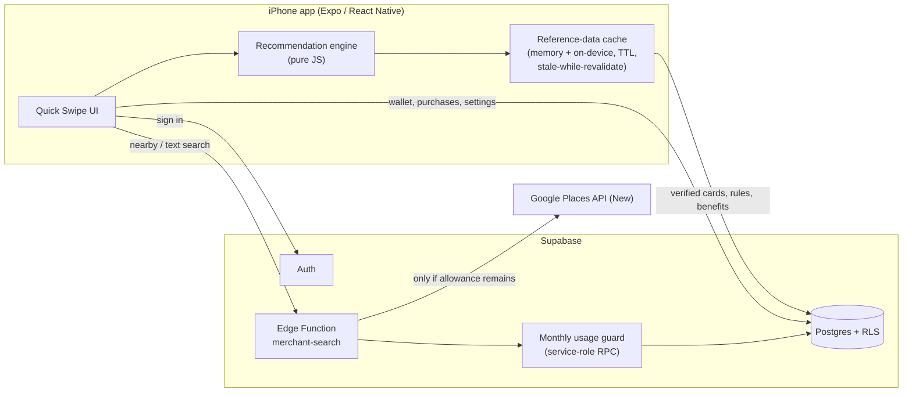

<p align="center">
  
</p>

<h1 align="center">SwipeWise</h1>

<p align="center"><b>Pick the best credit card you already own — for every purchase.</b></p>

<p align="center">
  
  
  
  
</p>

---

Many people carry several credit cards, each with different cashback rates, points multipliers, spending caps and merchant-specific rules. At the till, nobody remembers which card earns the most at *this* store for *this* purchase.

**SwipeWise** answers that in a few taps. You add the cards you own, tell the app where you're shopping, and it ranks **your own cards** for that purchase, explaining why the winner won.

Canada-first, iPhone-first, built with **Expo / React Native** and **Supabase**.

## How it works — the Quick Swipe flow

1. **In store or online?** You choose explicitly; GPS never decides this for you.
2. **Where?** Tap *Find Nearby Stores* to look up merchants around you via Google Places, or search/type the merchant manually.
3. **What are you buying?** Pick the purchase category.
4. **How much?** Only asked when the amount could actually change which card wins (e.g. a spending threshold or cap is in play).
5. **Result:** the best card, ranked alternatives, the reward rule that applied, plain-language reasons and any warnings.

## Highlights

### Deterministic recommendation engine
[`engine/recommendationEngine.js`](SwipeWise_Expo_Snack/engine/recommendationEngine.js) is a pure, side-effect-free decision module (~1,200 lines). No AI model picks the card: the same inputs always produce the same answer, and every result carries reason and warning codes.

- **Eligibility first:** only cards the user owns; cards a merchant is known not to accept are excluded, and unknown acceptance is kept with a warning.
- **Verified data only:** reward rules must be verified, active and within their effective dates; welcome/acquisition offers are excluded from checkout ranking.
- **Rule precedence by specificity:** merchant + exact category (400) → merchant + parent category (350) → exact category (300) → parent category (250) → base rate (100). One earning rule per reward stream, so base and category rewards are never double-counted.
- **Thresholds, caps and post-cap rates**, including caps shared across categories.
- **Points vs. cashback:** issuer reward facts are kept separate from SwipeWise's own point-value estimates, and ranking respects the user's preference (cashback, travel points or maximum overall value).
- **Stable tie-breaking**, so results never flicker between equal options.

Design notes: [`docs/RECOMMENDATION_ENGINE_V1.md`](SwipeWise_Expo_Snack/docs/RECOMMENDATION_ENGINE_V1.md)

### Secure Supabase backend
- **PostgreSQL schema** with 10 tables: user data (`profiles`, `user_settings`, `user_cards`, `purchases`, `recommendation_history`) and verified reference data (`banks`, `card_products`, `reward_rules`, `card_benefits`), plus a usage-tracking table.
- **Row Level Security on every table** (21 policies): users can only read and write their own rows; reference data is read-only to clients.
- **Indexed queries** for the hot paths (wallet lookups, rule lookups by card and category, purchase history by date).
- **Email/password auth** with **Keychain-backed sessions** and automatic profile creation on sign-up (`handle_new_user` trigger).
- **Idempotent writes:** logging a purchase is safe to retry, so a flaky connection never creates duplicate records.
- **Server-side secrets only:** no private keys ship in the app.

### Merchant lookup behind an Edge Function
- The app never holds the Google API key. Requests go through the Supabase Edge Function [`merchant-search`](SwipeWise_Expo_Snack/supabase/functions/merchant-search/index.ts) (JWT-verified, so only signed-in users can call it), which calls **Google Places API (New)** with a minimal field mask.
- **Server-side input validation and rate limiting:** search radius, result count and query length are clamped, and request rates are limited before anything reaches Google.
- **Debounced search with request de-duplication:** typing a merchant name doesn't fire a request per keystroke, and identical in-flight requests are shared.
- **Ambiguity handling:** when a search matches several places, the user picks the right one; manual entry is always available as a fallback.
- **Fail-closed cost guard:** before every Google request, the function atomically consumes one unit of a monthly allowance through a Postgres RPC that only the server role can execute. If the cap is reached or the guard fails, Google is never called and the app falls back to manual entry.
- **Merchant normalization** maps Google results to SwipeWise's own canonical merchants; Google place types are never treated as a guaranteed transaction category.

### Privacy by design
- Location is requested **only when the user taps** *Find Nearby Stores* (foreground only, never tracked in the background).
- Raw coordinates are **never stored** in purchase or recommendation history.
- The wallet never asks for card numbers, CVV, PIN or expiry dates.

### Caching and reliability
- **Two-level cache:** verified card reference data lives in memory and on device, with TTL-based freshness.
- **Stale-while-revalidate:** the app shows cached data instantly and refreshes it in the background, so checkout stays fast on a slow network.
- **Prefetching** of data the next screen is likely to need.
- **Exponential-backoff retries** for failed network calls.
- **Paginated purchase history** backed by indexed queries.

## Architecture



## Tech stack

| Layer | Tools |
|---|---|
| Mobile app | React Native 0.81, Expo SDK 54, React 19, `expo-location` |
| Backend | Supabase (PostgreSQL, Auth, Row Level Security, Edge Functions on Deno) |
| External data | Google Places API (New) — Nearby Search and Text Search |
| Testing | Node.js test scripts (engine scenarios, merchant context, usage-guard checks) |

## Tests

```bash
cd SwipeWise_Expo_Snack
npm install
npm test
```

| Suite | Checks |
|---|---|
| Recommendation engine | 28 deterministic scenarios (precedence, caps, thresholds, acceptance, lifecycle, tie-breaks) |
| Merchant context | 15 (normalization, aliases, online vs. in-store handling) |
| Google Places usage guard | 10 (atomic consume, role permissions, fail-closed behaviour, monthly boundary) |

## Run it locally

Prerequisites: Node.js, the Expo Go app (or a dev build) on an iPhone, and a Supabase project.

```bash
cd SwipeWise_Expo_Snack
cp .env.example .env        # add your Supabase URL and publishable key
npm install
npx expo start -c
```

Backend setup (schema, seed data, Edge Function secrets and the usage-guard migration) is covered in [`SUPABASE_SETUP.md`](SwipeWise_Expo_Snack/SUPABASE_SETUP.md) and the [app README](SwipeWise_Expo_Snack/README.md). Server-side secrets such as the Google Places key live only in Supabase Edge Function secrets — never in the app.

## Project structure

```
SwipeWise_Expo_Snack/
├── App.js                      # Screens: onboarding, Quick Swipe, wallet, insights, settings
├── engine/
│   ├── recommendationEngine.js # Pure decision logic
│   └── pointValuations.js      # SwipeWise point-value estimates (kept separate from issuer facts)
├── services/                   # Auth, wallet, purchases, profile, card reference data, merchants, location
├── config/merchantCatalog.js   # Canonical merchant identities and aliases
├── backend/                    # Postgres schema + demo seed
├── supabase/
│   ├── functions/merchant-search/  # Edge Function (Deno / TypeScript)
│   └── migrations/                 # Usage-guard table and RPC
├── tests/                      # Engine, merchant-context and guard test suites
└── docs/                       # Design notes, security review, QA records
```

## Roadmap

- [ ] New-card suggestions based on real spending (never pushy)
- [ ] Safari extension for online checkout

## Status

Development build (v0.5) running on iPhone through Expo. The card dataset covers a first set of verified Canadian credit cards.

---

Built by **Darshil Patel** — [LinkedIn](https://www.linkedin.com/in/darshilkumarpatel1) · [GitHub](https://github.com/Darshil2903)
